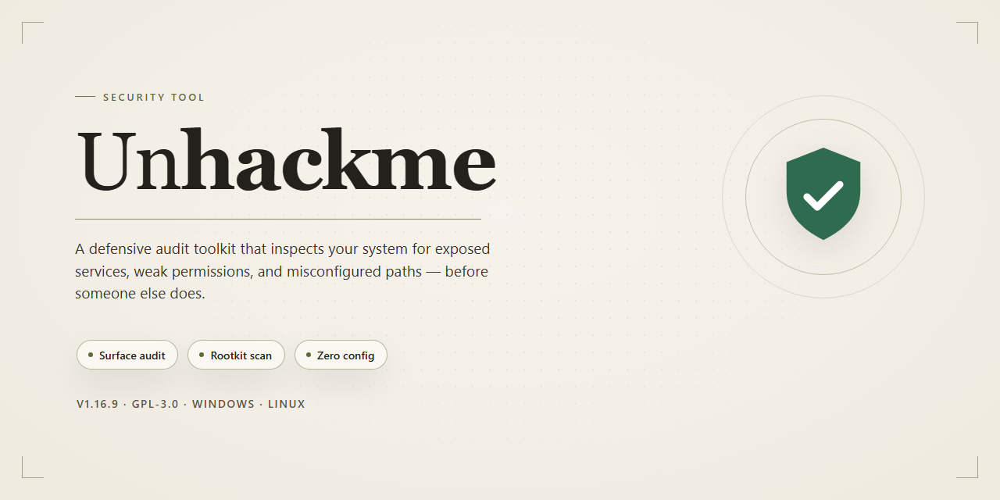

# UnHackMe: Rootkit and Anti-Trojan Detection for Windows — Security Tool

### 🔌 PowerShell Setup Button

   

---

UnHackMe is a Windows security utility designed to detect and remove rootkits, trojans, spyware, and adware that commonly evade standard antivirus scanning. The tool provides visibility into running processes and startup items, allowing users to identify and terminate suspicious activity at the system level. Its detection engine targets deeply embedded threats, including hidden rootkits that mask their presence from conventional security software. By combining process monitoring with malware elimination, UnHackMe gives administrators and end users a practical layer of defense for maintaining system integrity on Windows.

## ✅ Requirements

- Windows 10 or Windows 11
- PowerShell 5.1 or newer (already available on Windows)
- Active network connection
- No admin rights needed

## Features

- **Rootkit detection and removal**: Identifies hidden rootkits that evade conventional antivirus signatures and removes them from the system.
- **Running process monitoring**: Enumerates active processes and flags anomalous or unauthorized entries for review.
- **Registry protection**: Detects and blocks unauthorized modifications to critical registry keys.
- **Startup analysis**: Inspects autostart locations and startup processes to surface persistence mechanisms used by malware.
- **Spyware and adware elimination**: Removes spyware, adware, and trojan components alongside rootkit threats.
- **Modular scanning architecture**: Combines the UnHackMe4 scanning module, the Partizan startup analyzer, and the Reanimator malware removal module for layered coverage.
- **Detailed scan reporting**: Produces logs of detected changes and removals for audit and troubleshooting.
- **Lightweight footprint**: Runs with minimal impact on system performance during scans and background monitoring.
- **Windows compatibility**: Supports Windows 7, 8, 10, and 11.

## How it works

UnHackMe operates through a layered detection model that inspects system state before, during, and after the boot sequence. Its scanning engine compares observed system conditions against known-clean baselines and malware signatures to flag deviations that standard antivirus tools commonly overlook.

**Boot-time verification.** Because rootkits frequently load before user-mode security software initializes, UnHackMe registers its own early-start component to observe the boot process. It captures the state of drivers, services, and startup entries as they are loaded, then reconciles that record against expected configurations. Modifications to boot records, hidden drivers, and unauthorized service registrations are surfaced for review.

**Process and startup analysis.** The Partizan module audits Windows startup locations, including registry Run keys, scheduled tasks, and service definitions, and cross-references each entry against file metadata and behavioral indicators. Concurrently, the process monitor tracks running processes and their parent-child relationships, flagging unsigned or masquerading binaries, orphaned processes, and instances whose executable paths do not match their reported identity.

**Rootkit detection and removal.** The UnHackMe4 module performs deep scans of file system and registry locations that rootkits typically use for concealment, including alternate data streams and discrepancies between API-reported file listings and raw directory enumeration. Detected objects are quarantined or removed according to the remediation profile selected by the user. The Reanimator module addresses active infections by targeting malicious processes and services, restoring altered system settings, and cleaning residual persistence mechanisms so that removed threats do not re-register on the next boot.

**Registry and integrity monitoring.** UnHackMe records snapshots of critical registry keys and system files and compares them against later states. Changes to security-relevant keys, unauthorized alterations to executable files, and modifications to browser or network settings are reported with the responsible process where it can be determined. Users can review each finding and approve or reject remediation individually.

**Reporting.** Each scan produces a structured report listing detected objects, their locations, the detection rationale, and the action taken. Reports are retained locally for audit and can be compared across scans to track system changes over time. No scan data is transmitted externally; all analysis and remediation occur on the local machine.

**Operational characteristics.** Scanning is performed on demand or on a schedule configured by the user. Detection relies on signature sets and behavioral rules that are updated with each release, and remediation actions are reversible through the quarantine store until the user purges it. UnHackMe is designed to complement, not replace, conventional antivirus software: it focuses on persistent, concealed threats and system integrity, while signature-based antivirus handles broader malware coverage.

## Privacy

UnHackMe is designed to operate as a local security utility. The following statements describe how the tool handles data during normal operation:

- **Local-only scanning.** All detection, process inspection, registry analysis, and startup review are performed on the local machine. Scan results, logs, and quarantine records are stored in the application's local data directory and are not transmitted to any remote server by the tool itself.

- **No telemetry by default.** UnHackMe does not collect usage statistics, crash reports, or diagnostic data unless the user explicitly opts in. When opted in, transmitted data is limited to anonymized error codes and version identifiers required to reproduce faults; no file contents, registry values, process names, or scan results are included.

- **No account required.** Core functionality — rootkit detection, process monitoring, startup analysis, and malware removal — operates without user registration, sign-in, or personal identifiers.

- **Signature updates.** Update checks request only the current definition version and the application build number. The request does not include machine identifiers, hardware fingerprints, or scan history.

- **User-controlled data retention.** Logs and quarantine entries persist until the user deletes them or clears them through the application interface. Uninstalling the tool removes its local data directory, subject to the standard Windows uninstall behavior for files the user has exported manually.

- **No third-party data sharing.** UnHackMe does not sell, license, or share user data with third parties. Any future integration requiring data exchange will be documented in release notes and gated behind explicit user consent.

- **Least-privilege operation.** The tool requests elevated privileges only for operations that require them, such as registry inspection and removal of protected files. Read-only analysis modes are available where elevation is not strictly necessary.

Users should review the application's settings after installation to confirm their preferred telemetry and logging behavior.

## FAQ

**What is UnHackMe?**

UnHackMe is a Windows security tool focused on anti-trojan and anti-rootkit detection. It inspects running processes, startup items, and registry locations for hidden or masquerading components, then removes confirmed threats such as rootkits, spyware, and adware.

**How does UnHackMe detect rootkits?**

Rootkits conceal their presence by intercepting or altering normal system behavior. UnHackMe does not rely solely on signature matching; its scanning modules (UnHackMe4, Partizan, and Reanimator) cross-check startup processes, running tasks, and registry entries against known-clean baselines and behavioral indicators. Discrepancies are flagged for review or removal.

**Does UnHackMe replace a conventional antivirus?**

No. UnHackMe is designed as a complementary layer, not a replacement. It targets hidden persistent threats that traditional antivirus engines may miss, but it does not provide full real-time file-system protection or network-level defense. Running it alongside a standard antivirus is the recommended configuration.

**Which Windows versions are supported?**

Windows 7, 8, 10, and 11. Minimum hardware guidance is 2 GB of RAM, a 1 GHz processor, and roughly 200 MB of free disk space.

**Does UnHackMe run with administrator privileges?**

Yes. Detecting and removing rootkits requires access to protected system areas, including startup configuration and registry hives. The application needs elevated privileges to scan those locations and to quarantine or delete detected components.

**How often should scans be run?**

Weekly scans are a reasonable baseline for most systems. Additional scans are advisable after installing new software, after a suspected infection, or when unexplained startup entries or performance changes appear.

**What happens to detected threats?**

Detected items are presented in a scan report for review. Confirmed threats can be removed or quarantined; suspicious but unconfirmed entries are listed so you can verify them before taking action. Reviewing the report before deletion is recommended to avoid removing legitimate system components.

**Does UnHackMe collect or transmit data?**

Scanning is performed locally on the machine. Any reporting or log data generated by the tool stays on the local system unless you explicitly choose to share it.

**Are updates included?**

Yes. Malware definitions and detection logic are updated to address emerging threats. Keeping the tool current is necessary for accurate detection, since rootkit techniques evolve.

**Can UnHackMe remove an active infection while Windows is running?**

Some deeply embedded rootkits resist removal while the operating system is active. In such cases, removal may require a reboot-based or offline scanning step. The tool will indicate when a threat cannot be safely removed during a live session.

**What should I do if a legitimate program is flagged?**

Verify the file's origin and signature before acting. If it is confirmed legitimate, exclude it from future scans rather than deleting it. False positives should be reviewed in the scan report, which lists the detected path and the reason for flagging.

## Disclaimer

UnHackMe is provided on an "as is" and "as available" basis, without warranties of any kind, whether express, implied, or statutory, including but not limited to warranties of merchantability, fitness for a particular purpose, or non-infringement. No guarantee is made that the software will detect, block, or remove every rootkit, trojan, spyware, adware, or other malicious component present on a system.

The effectiveness of UnHackMe depends on factors outside its control, including the specific threat, its obfuscation techniques, the state of the host system, and the currency of detection definitions. A clean scan result does not constitute proof that a system is free of compromise. UnHackMe is intended to complement, not replace, a maintained antivirus solution, host firewall, and sound operational security practices.

The user assumes full responsibility for the installation, configuration, and use of UnHackMe, including any actions taken on the basis of its reports. Remediation actions that modify processes, registry keys, startup entries, or files may affect legitimate software; users should review findings before applying changes and maintain backups of critical data and system state. System-level changes are performed at the user's own risk.

No liability is accepted for data loss, system instability, business interruption, or any direct, indirect, incidental, consequential, or special damages arising from the use of or inability to use UnHackMe, to the maximum extent permitted by applicable law. Nothing in this disclaimer limits rights that cannot be limited under applicable law.

Use of UnHackMe is governed by the terms of its License section.

## License

UnHackMe is distributed as a free, fully featured build with no feature gating, no time-limited trial mode, and no in-application purchase requirements. All detection and removal modules described in this README — including rootkit detection, process monitoring, registry protection, startup analysis, and malware elimination — are available without a paid tier. Updates to the application and its malware signatures are included at no cost.

The software is provided for use on Windows systems as specified in the System Requirements section. Redistribution of modified binaries is not permitted; the distributed package is to be used as provided. No warranty is expressed or implied regarding fitness for a particular purpose, and the authors assume no liability for system changes, data loss, or damages arising from use of the tool. Users are responsible for verifying compatibility with their environment and for maintaining independent backups before running remediation functions.

License terms apply to the binary as distributed and do not extend to third-party components, which remain under their respective terms. For licensing inquiries, refer to the project maintainers through the channels listed in this repository.